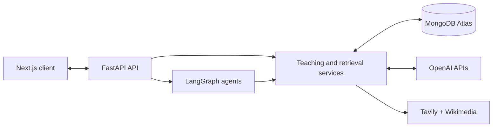
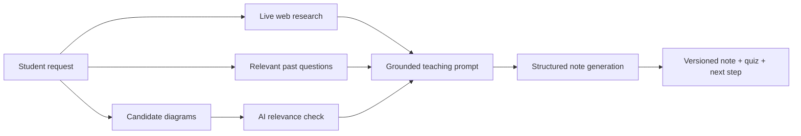

# StudyMaster AI Server

### The curriculum, retrieval and real-time teaching engine behind StudyMaster

[](https://fastapi.tiangolo.com/)
[](https://www.python.org/)
[](https://openai.com/)
[](https://www.mongodb.com/atlas)

**[Use the live product](https://studymaster-rho.vercel.app)** · **[View the client repository](https://github.com/ajalaabdullah-webdev/studymaster-client)**

---

## Why this server exists

StudyMaster is built for a specific educational problem: Nigerian WAEC and JAMB candidates often
have access to information but not to a continuous feedback loop. A generic answer does not know the
student's goal, what the examination repeatedly tests, what the student misunderstood yesterday or
what they should practise next.

This server is the “teacher brain” behind the product. It coordinates retrieval, generation,
real-time voice, a synchronized teaching board, assessments, roadmaps and progress signals so that
every feature contributes to one learning journey.

## The evidence behind the mission

StudyMaster is a response to measured outcomes, not a technology demo:

- **74% of Nigerian children aged 7–14 lack basic reading and mathematics skills**, according to
  [UNICEF Nigeria](https://www.unicef.org/nigeria/press-releases/immediate-action-needed-protect-nigerias-children-and-schools).
- Nigeria needs **nearly 200,000 trained teachers**; UNICEF also reports that only 27% of children
  aged 7–14 have reading-comprehension skills and 25% can solve simple mathematics problems
  ([2024 situation analysis](https://www.unicef.org/nigeria/media/10591/file/State-of-Nigerias-Children_Summary-of-the-2024-Updated-SitAn.pdf)).
- JAMB's final post-retake 2025 figures show **29.08% of 1,925,463 candidates scored 200 or above**,
  while only **6.03% reached 250** and **0.87% reached 300**
  ([official JAMB bulletin](https://www.jamb.gov.ng/Bulletin/2025/JAMBulletin_26-05-2025.pdf)).
  These are score distributions, not a claim that 200 is a universal pass mark; admission thresholds
  differ by institution and programme.
- Corrected 2025 WASSCE data show **62.96% earned five credits including English and Mathematics**,
  compared with 72.12% in 2024
  ([Federal Ministry of Information, citing WAEC](https://fmino.gov.ng/fg-reaffirms-zero-tolerance-for-exam-malpractice-as-waec-performance-and-credibility-improve/)).
  Against 1,969,313 candidates, that leaves roughly **729,000 students below this benchmark**.

The server turns those broad problems into product mechanisms that can be evaluated:

| National/student problem | Server mechanism | Observable signal |
|---|---|---|
| Unresolved foundational gaps | Diagnostic baseline and level-aware generation | Baseline-to-assessment improvement |
| Scarce individual feedback | Stateful GPT-Live classroom and in-lesson checks | Lesson completion and question results |
| Generic study material | RAG grounded in live sources and real WAEC/JAMB questions | Retrieved evidence attached to each learning flow |
| Past questions hidden behind different wording | Topic labels + vector search + keyword expansion | Search relevance across paraphrases |
| Passive reading | Generated quizzes, explanations and next-step recommendations | Quiz accuracy and repeated-error patterns |
| Fragmented progress | Unified activity and readiness engine | Trends across notes, practice, exams and lessons |

This is the product thesis encoded in the architecture: **personal teaching, exam-grounded practice
and continuous feedback should not be available only to the student who can afford a private tutor.**

## What the server powers

- a low-latency one-to-one **Live Learning** classroom;
- RAG-powered, evidence-grounded and **versioned study notes**;
- hybrid retrieval over **23,355 scraped past questions**;
- topic practice, explanations, quizzes and mock examinations;
- career-aware onboarding, diagnostics and personal roadmaps;
- exam-readiness estimation and study-activity analytics;
- authentication, community, games, subscriptions and administration.

---

## Architecture at a glance



FastAPI is the secure boundary. The client never receives private provider keys. JWT authentication,
ownership checks, model calls, database writes and external research all happen here.

## The 23,355-question intelligence layer

StudyMaster's question bank was assembled from more than **23,000 scraped examination questions**.
The student-facing product focuses on WAEC and JAMB. Raw archives, however, are not enough: ordinary
keyword search fails when the student's phrase and the examiner's wording differ.

The ingestion and retrieval pipeline therefore adds:

- normalized examination, subject, year and topic metadata;
- AI-generated topic labels;
- a 256-dimensional `text-embedding-3-small` vector for semantic meaning;
- a MongoDB Atlas vector index; and
- cached keyword expansion for curriculum vocabulary.

At query time, `topic_search.py` merges three layers:

| Retrieval layer | Purpose |
|---|---|
| Exact label/text match | Rewards questions explicitly about the requested topic |
| Atlas Vector Search | Recovers semantically related questions with different wording |
| AI keyword expansion | Connects syllabus terms such as “number bases” with binary, octal and denary |

Exact matches are deliberately weighted above fuzzy semantic neighbours. If vector search is
temporarily unavailable, the other layers continue working, so retrieval degrades rather than
collapses.

### Why 256-dimensional vectors?

The project evaluated multiple embedding sizes. For these short exam questions, 256 dimensions
preserved a strong relevant-versus-irrelevant separation while reducing the stored vector footprint
to roughly 2 KB per question—about 48 MB across the bank instead of roughly 280 MB at 1,536
dimensions.

---

## Retrieval-Augmented Generation for notes

The note agent uses retrieval before generation:



The system retrieves current topic context, exam evidence and educational images before asking a
model to teach. Candidate Wikimedia diagrams are checked for relevance rather than inserted blindly.
The result streams to the browser and is stored as a version, allowing later requests to deepen or
advance the lesson without overwriting prior understanding.

The agent also receives previous note context. A request for calculations after a conceptual
introduction can therefore continue the learning sequence instead of regenerating the same overview.

---

## Live Learning: one voice, one board, one lesson state

Live Learning begins before the microphone opens. The `/prepare` flow builds a structured notebook
around the subject, topic, learner level, stated difficulty, goal and selected duration. The browser
polls preparation progress, then negotiates a direct WebRTC session with OpenAI GPT-Live through a
server-created session.

During class:

1. **GPT-Live speaks and listens in real time.** The student can interrupt naturally.
2. **Client-side delegation** requests bounded actions without exposing secrets.
3. **OpenAI Decisions** classifies spoken sentences as skip, teaching point, key rule, formula or
   calculation working.
4. Ordinary board lines come from the teacher's own transcript; symbolic speech is converted to
   verified LaTeX.
5. Board operations, notebook page, transcript, elapsed time and quiz results are persisted.
6. A paused lesson can resume from its last page, and a timed lesson can be extended.

This avoids the classic “two minds” problem where one model speaks while another independently
guesses what to place on the board. The board scribe is anchored to what the teacher actually said,
so voice and visual explanation remain coherent.

### Key endpoints

| Endpoint | Role |
|---|---|
| `POST /api/v1/live-learning/prepare` | Create a lesson and start notebook preparation |
| `GET /api/v1/live-learning/{id}/notebook` | Read preparation progress and the completed notebook |
| `POST /api/v1/live-learning/session` | Exchange WebRTC SDP and start/resume GPT-Live |
| `POST /api/v1/live-learning/{id}/page` | Persist the active teaching page |
| `POST /api/v1/live-learning/{id}/ops` | Persist board additions and lesson notes |
| `POST /api/v1/live-learning/{id}/quiz-result` | Record an in-class assessment |
| `POST /api/v1/live-learning/{id}/pause` | Save a resumable classroom state |
| `POST /api/v1/live-learning/{id}/complete` | Finalize the class and activity record |

---

## Personalisation and readiness

The onboarding agent researches Nigerian university and career requirements, validates WAEC/JAMB
subject combinations, establishes target scores and creates a diagnostic baseline. The roadmap agent
then turns the gap between baseline and goal into phases, levels and study tasks.

The readiness engine consumes behavioral and assessment signals—including notes, quizzes, question
practice, mock exams, diagnostics and live lessons—to produce a stable estimate for each selected
exam. The estimate is intentionally smoothed so one lucky quiz cannot create a misleading leap.

---

## Model and service strategy

| Capability | Implementation | Reason |
|---|---|---|
| Everyday generation | `gpt-4o-mini` through LiteLLM | Fast, economical notes and explanations |
| Higher-stakes reasoning | `gpt-4o` through LiteLLM | Marking, checking and harder reasoning |
| Live classroom | `gpt-live-1` via WebRTC | Low-latency native speech conversation |
| Fast bounded routing | OpenAI Decisions (`gpt-6-luna`) | Split-second constrained classroom choices |
| Delegated lesson reasoning | `gpt-6-luna` | Accurate live teaching actions and lesson packs |
| Semantic retrieval | `text-embedding-3-small`, 256 dimensions | Meaning-based question search at practical storage cost |
| Note narration | `gpt-4o-mini-tts` | Warm read-aloud with synchronized client highlighting |
| Live research | Tavily | Current curriculum and requirement context |
| Educational media | Wikimedia + relevance verification | Useful diagrams rather than decorative images |

All ordinary text generation passes through `app/core/llm.py`, a LiteLLM abstraction. Models can be
changed with environment variables instead of rewriting every agent.

## Technology stack

- **Python 3.11+**, FastAPI, Uvicorn, Pydantic
- **Beanie** on the asynchronous PyMongo client
- **MongoDB Atlas** and Atlas Vector Search
- **LangGraph** and LangChain Core
- **OpenAI** Live, Decisions, text, speech and embedding APIs
- **LiteLLM** provider routing
- **Tavily**, Wikimedia and Cloudinary
- JWT, bcrypt and Google OAuth
- Server-Sent Events for streamed note generation
- Resend for transactional email
- Render deployment through `render.yaml`

## OpenAI Codex engineering contribution

OpenAI Codex worked across this server as an engineering collaborator over multiple development
sessions, not simply as a code-completion tool. Primary Codex agents coordinated multiple specialist
subagents across research, scraping, data engineering, backend implementation, testing and review,
then integrated and verified their work.

Codex helped build and run the data-collection workflow that scraped **23,355 past questions**, then
cleaned and normalized the records, generated curriculum-aware topic labels, created 256-dimensional
embeddings, built the Atlas vector index and implemented the hybrid retrieval strategy. It also
implemented major
parts of versioned note generation, OpenAI speech, the GPT-Live classroom, Decisions-based board
classification, persisted lesson state and the associated API contracts.

The project uses reusable custom Codex skills and repository working agreements for phased delivery,
software engineering, design quality, motion, review and verification. Multi-agent orchestration was
part of the build: primary agents delegated bounded workstreams to subagents while retaining
responsibility for architecture, shared-state coordination, integration and final verification. The
same workflow remains available for future StudyMaster development.

See **[CODEX_WORKFLOW.md](./CODEX_WORKFLOW.md)** for the detailed contribution record and the boundary
between product-owner decisions and Codex-assisted engineering.

---

## Run locally

### Requirements

- Python 3.11+
- [`uv`](https://docs.astral.sh/uv/)
- MongoDB Atlas or a compatible MongoDB database
- Node.js 20+ for the [client](https://github.com/ajalaabdullah-webdev/studymaster-client)

```bash
git clone https://github.com/ajalaabdullah-webdev/studymaster-server.git
cd studymaster-server
uv sync
cp .env.example .env
```

At minimum, configure MongoDB and authentication:

```env
MONGODB_URI=your-mongodb-connection-string
MONGODB_DB=studymaster
JWT_SECRET=replace-with-a-long-random-secret
FRONTEND_URL=http://localhost:3000
CORS_ORIGINS=http://localhost:3000
```

Add the provider keys needed by the features you intend to run, then start the API:

```bash
uv run uvicorn app.main:app --reload --port 8000
```

Checks:

```bash
curl http://localhost:8000/health
uv run ruff check app
```

The client should use:

```env
NEXT_PUBLIC_API_URL=http://localhost:8000/api/v1
```

## Question-bank maintenance

The data scripts are resumable and designed to be safe to rerun:

```bash
uv run python scripts/label_topics.py
uv run python scripts/embed_questions.py
uv run python scripts/create_vector_index.py --wait
uv run python scripts/normalize_topics.py
```

Run labeling before embedding because the topic label is deliberately included in the embedded text.

## Project map

```text
app/agents/       Multi-step note, onboarding and roadmap agents
app/core/         Authentication, IDs, LLM routing and subject normalization
app/models/       Beanie/MongoDB documents
app/routers/      FastAPI product endpoints
app/services/     Retrieval, live teaching, readiness, media and speech logic
app/schemas/      Request and response contracts
scripts/          Question labeling, embedding, indexing and verification tools
architecture.md   Full plain-English system tour
```

## Deployment

The service is configured for Render through `render.yaml`. Production secrets belong in the Render
environment and must never be committed. The deployed client is available at
[studymaster-rho.vercel.app](https://studymaster-rho.vercel.app).

---

## The engineering principle

StudyMaster treats AI as one component inside a measurable learning system. Retrieval constrains what
the model teaches, assessments test whether the learner understood it, persistence preserves the
journey, and readiness signals decide what should happen next.

The goal is not to produce more content. It is to help a student make better progress with every
study session.
