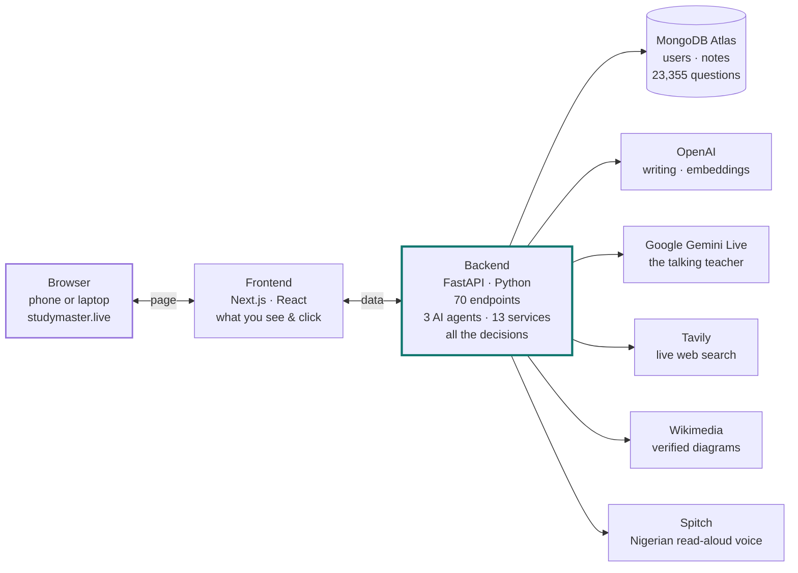
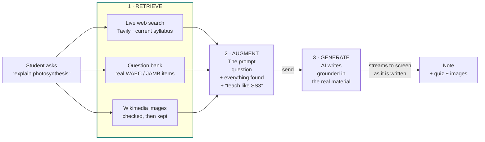
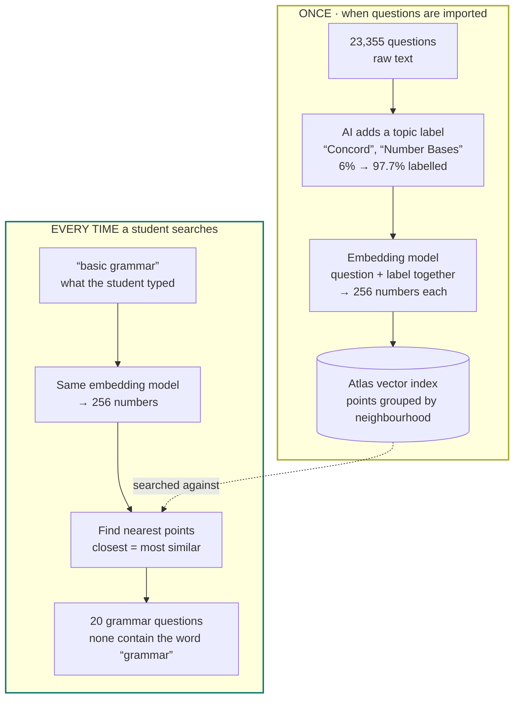
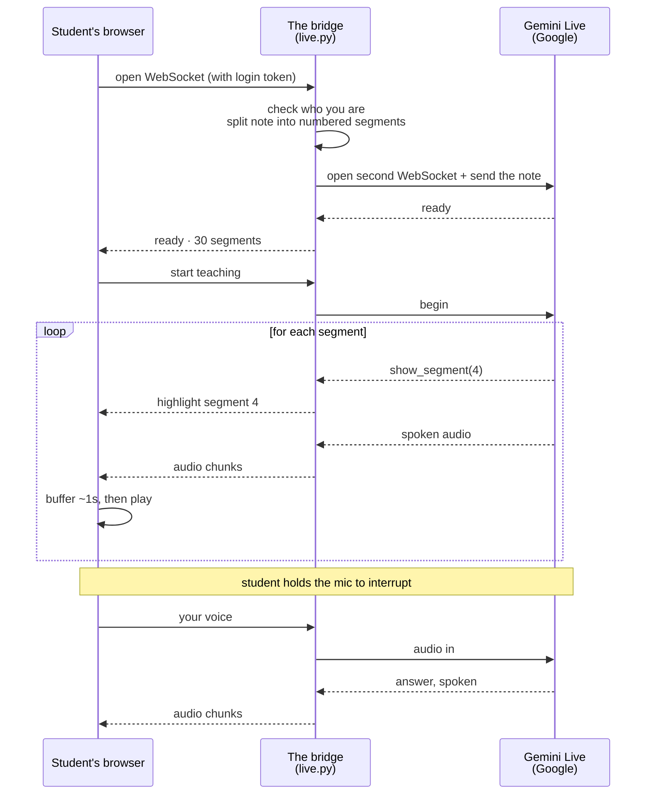

# How StudyMaster Works

A complete tour of the machine behind the app — every service, every AI model, and every piece of
jargon explained from scratch. No prior knowledge assumed.

| | |
|---|---|
| **Platform** | WAEC & JAMB exam prep, Nigeria |
| **Question bank** | 23,355 questions |
| **Frontend** | Next.js on Vercel — [studymaster.live](https://www.studymaster.live) |
| **Backend** | FastAPI (Python) on Render |
| **Database** | MongoDB Atlas |

**Contents**

1. [The one-paragraph version](#the-one-paragraph-version)
2. [The whole system, in one picture](#the-whole-system-in-one-picture)
3. [The five pieces explained](#the-five-pieces-explained)
4. [The four AI models, and why each one](#the-four-ai-models-and-why-each-one)
5. [Notes: how RAG actually works](#notes-how-rag-actually-works)
6. [Search: embeddings and the vector database](#search-embeddings-and-the-vector-database)
7. [Live Teach: the hardest part](#live-teach-the-hardest-part)
8. [Onboarding and the roadmap](#onboarding-and-the-roadmap)
9. [Where everything is stored](#where-everything-is-stored)
10. [Plain-English glossary](#plain-english-glossary)

---

## The one-paragraph version

A student opens StudyMaster in their browser. The page they see is served by one computer; the
thinking happens on another.

That second computer — the **backend** — is the brain. When a student asks for a note on
photosynthesis, the backend searches the live web, pulls real past questions out of a database, finds
verified diagrams, and only then asks an AI to write the note using all of that as source material.
When a student taps *Live Teach*, the backend opens a phone-call-like connection to Google's voice AI
and relays audio in both directions while highlighting the note on screen.

Everything else in this document is detail underneath those two sentences.

---

## The whole system, in one picture

Five groups of machines. The student only ever touches the first one.



The student's browser only ever talks to StudyMaster's own two servers. **Every AI service is
contacted by the backend, never by the browser** — which is what keeps the API keys secret. Even Live
Teach audio is relayed through the backend rather than connecting the browser straight to Google.

---

## The five pieces explained

### 1. The browser — what the student sees

A phone or laptop at `studymaster.live`. It draws the buttons, plays the audio, and collects taps. It
holds no secrets and makes no decisions.

### 2. The frontend — the face

Built with **Next.js** (a framework built on React) and hosted on **Vercel**. Fifteen pages:
dashboard, notes, past questions, exam, roadmap, coach, community, settings and more. Its job is
presentation — it asks the backend for everything real.

*Why a separate host?* Vercel is built for websites: it copies your pages to servers around the world
so a student in Lagos loads them from nearby.

### 3. The backend — the brain

Built with **FastAPI** in Python, hosted on **Render**. This is where all the intelligence lives:
**70 endpoints** (specific things it can be asked to do), **3 AI agents** and **13 services**.

An *endpoint* is just a labelled door. `/api/v1/notes` is the door for notes;
`/api/v1/questions/search` is the door for searching questions. The frontend knocks on a door and gets
an answer back.

### 4. The database — the memory

**MongoDB Atlas**, running in the cloud. It stores users, notes, chats, quiz scores, roadmaps, study
activity and the 23,355-question bank. Turn every server off and on again and nothing here is lost.

### 5. The outside services — hired specialists

StudyMaster doesn't build its own AI. It hires five specialists, each for one job, and the backend is
the only thing allowed to call them.

---

## The four AI models, and why each one

Different jobs need different machines. Using the most powerful model for everything would be like
hiring a surgeon to cut your hair — expensive and no better.

| Model | Used for | Why this one |
|---|---|---|
| `gpt-4o-mini` | Everyday writing — notes, explanations, coach replies | Fast and cheap. Handles 90% of the work. |
| `gpt-4o` | Harder thinking — marking theory answers, verification | Smarter, pricier. Saved for when accuracy really matters. |
| `text-embedding-3-small` | Turning text into numbers for search | Doesn't write anything — it only measures meaning. |
| `gemini-2.5-flash-native-audio` | Live Teach — the talking teacher | Hears and speaks directly, with no text step in between. |

> **Design decision.** All text models are reached through a translator library called **LiteLLM**.
> StudyMaster's code never says "call OpenAI" — it says "call the default model". Switching the whole
> platform from OpenAI to a cheaper provider is a one-line change, not a rewrite. That matters when
> model prices move.

---

## Notes: how RAG actually works

This is the feature people mean when they say "RAG". Here is what those three letters do.

If you asked an AI directly for a note on photosynthesis, it would answer from memory — and its memory
is a blur of everything on the internet, with no idea what the Nigerian syllabus expects or how WAEC
phrases its questions. It would sound confident and be subtly wrong.

**RAG** stands for **Retrieval-Augmented Generation**. In plain English: *go and find real facts
first, staple them to the question, and only then let the AI write.*



Remove the retrieval step and the AI still writes a note — it just writes one from vague memory
instead of from the current syllabus and real past questions.

### Why the images get checked

Wikimedia will happily return a photo of a garden when you ask for a photosynthesis diagram. So after
fetching candidates, StudyMaster shows them to an AI and asks whether each one actually illustrates
the topic. Rejects are dropped. Three to five survivors go into the note.

### Why the note appears word by word

Writing a full note takes up to two minutes. Rather than a spinner, the backend uses **streaming** —
it sends each fragment the instant the AI produces it. The student watches the note being written,
which feels dramatically faster than the same wait behind a loading icon.

---

## Search: embeddings and the vector database

This is the part that sounds most like magic, and is actually the simplest idea in the whole system.

### The problem

A real English question in the bank reads:

> *"Choose the option that best completes the sentence. He did not attend the final burial…"*

A student searches **"basic grammar."** Ordinary search asks: does the text contain the word "basic"?
Does it contain "grammar"? No and no. **Zero results** — for a question that is obviously about
grammar.

Ordinary search matches *letters*. What was needed was something that matches *meaning*.

### The idea: turn meaning into numbers

An **embedding model** reads a sentence and returns a list of numbers — for StudyMaster, **256 of
them**. Those numbers *are* the meaning, as far as a computer is concerned.

```
"Plants make their own food using sunlight."
   ↓
[-0.021, 0.0163, 0.0335, 0.083, 0.1777, -0.0066, ... ]   ← 256 numbers
```

The model was trained so that sentences meaning similar things get similar numbers, **even when they
share no words at all**. Think of each number as a coordinate: two numbers place a dot on paper, three
place it in a room, 256 place it in a space nobody can picture — but the maths is identical. Related
ideas land near each other.

Measured against *"How plants make food using sunlight"*:

| Sentence | Closeness |
|---|---|
| The process by which plants feed themselves | **0.641** |
| Green leaves convert light into glucose | **0.568** |
| Photosynthesis occurs in the chloroplast | **0.481** |
| Calculate the roots of a quadratic equation | 0.071 |
| The Nigerian civil war began in 1967 | 0.014 |

The top three share almost no words with the question — "chloroplast" and "glucose" appear nowhere —
yet they score high. The bottom two share ordinary words like "the" and "of" and score near zero.
**That is the entire trick: meaning, not spelling.**

### How it runs



Both lanes use the **same** embedding model — that is what makes the comparison meaningful, since a
query and a question must be measured on the same ruler.

### Why the label step exists

This was measured, not assumed:

| What was embedded | Score vs "basic grammar" |
|---|---|
| The raw question text | **0.15** — effectively unrelated |
| The question **+ its topic label** | **0.31** — twice as close |

The raw question — *"He did not attend the final burial…"* — has no grammar vocabulary for the vector
to grab onto. Adding the label "Concord" injects the missing meaning. **That is why labelling must run
before embedding**, and why `build_text()` includes the labels.

### Why a vector *database* and not just a loop

Comparing two vectors means multiplying them number by number: 256 multiplications per question.
Across the bank that's roughly **6 million multiplications for every single search**.

A vector database avoids that. MongoDB Atlas builds an **index** that groups the points by
neighbourhood ahead of time — like a phone book grouping by first letter so you never read every name.
A search jumps to the right region instead of checking everything.

### Where 256 comes from

It's a setting, not a law of nature — [`app/config.py`](app/config.py) sets
`embedding_dimensions: int = 256`. The model's *native* size is 1536; OpenAI's v3 models are trained
so the most important information sits in the earliest numbers, so you can ask for fewer — like saving
a JPEG at lower quality and still recognising the picture.

Measured on real StudyMaster data, comparing a correct match against a wrong one:

| Dimensions | Correct match | Wrong match | Gap | Size per question |
|---|---|---|---|---|
| 1536 (native) | 0.576 | 0.099 | 0.478 | 12.0 KB |
| 512 | 0.597 | 0.049 | 0.548 | 4.0 KB |
| **256 (chosen)** | **0.601** | **−0.009** | **0.609** | **2.0 KB** |
| 64 | 0.648 | −0.141 | 0.789 | 0.5 KB |

At 256 the *gap* — how clearly the right answer beats the wrong one — is as good as at 1536, for a
sixth of the storage. Across the bank that's **~48 MB instead of ~280 MB**, which matters on a free
Atlas cluster shared with another application.

### StudyMaster doesn't rely on vectors alone

Pure vector search is fuzzy. It finds things that are *sort of* related, which is wrong when a student
explicitly asks for "number bases". So the real search runs **three layers** and merges them:

| Layer | What it does | Score | Cost |
|---|---|---|---|
| Label & text match | Direct match on the topic label or question text | 100 / 60 | Free |
| Semantic (vectors) | Nearest neighbours — catches unexpected phrasings | 40 × closeness | Fractions of a penny |
| Keyword expansion | AI turns "number bases" into binary, octal, denary… | 8 per hit | Once ever, then cached |

Exact label matches score highest, so a question actually labelled "Number Bases" always outranks a
vague semantic cousin. And if the vector index ever vanished, layers one and three still work — the
search gets worse, it doesn't break.

> **Honest limits.** Vectors don't understand "not" — *photosynthesis* and *not photosynthesis* land
> close together. New questions stay invisible to the semantic layer until they're labelled and
> embedded, in that order. And a high score means "related", never "correct".

---

## Live Teach: the hardest part

Every other feature is a question followed by an answer. Live Teach is a continuous conversation, and
that changes everything about how it must be built.

Normal web requests work like letters: you send one, you get one back, the exchange is over. A live
lesson can't work that way — audio has to flow in both directions, continuously, for as long as the
lesson lasts. That needs a **WebSocket**: a line held open, like a phone call.



The bridge is the whole feature. It is the only component holding the API key, the only one that knows
which segment is being taught, and the only one that can reconnect to Google without the student
noticing.

### How the highlighting stays in sync

The note is chopped into numbered **segments** — heading, paragraph, image, and so on — and that
numbered list is handed to the AI along with an instruction: *before you speak about a segment, call
`show_segment` with its number.*

So the AI announces where it is. The bridge forwards that number to the browser, and the browser lights
up that part of the note. **The highlight follows the voice because the voice is what triggers it.**

### Why the browser buffers a second of audio

Audio arrives from Google in small chunks over the internet, which is never perfectly smooth. If each
chunk played the instant it landed, the voice would stutter on every hiccup. So the browser keeps about
**one second in reserve** and plays from the reserve — small delays drain the buffer instead of
breaking the speech. It's the same trick that keeps a WhatsApp call intelligible on bad signal.

### What happens when it fails

Google deliberately resets these connections roughly every ten minutes, and preview models sometimes
drop out unexpectedly. The bridge handles both by reconnecting and asking the teacher to continue from
the last segment it taught. Done fast enough, the audio buffer covers the gap and the student notices
nothing.

> ⚠️ **Current limitation.** On a free hosting plan the backend sleeps after about 15 minutes of no
> traffic, and a sleeping server drops open connections. Ordinary pages just load slowly after a nap;
> Live Teach **fails**, because its connection can't survive the sleep. That's the single strongest
> reason to move off the free plan before real students arrive.

---

## Onboarding and the roadmap

Most study apps ask which subjects you take. StudyMaster asks what you want to become, then works
backwards.

```mermaid
flowchart LR
    A["1 · Pick the exam<br/>WAEC, JAMB, or both"]
    B["2 · Phone & school<br/>so an advisor can reach you"]
    C["3 · Type the career<br/>“Software Engineering”"]
    D["Live web search<br/>what Nigerian unis<br/>actually require — today"]
    E["4 · Confirm subjects<br/>compulsory ones pre-ticked"]
    F["5 · 10-question diagnostic<br/>a starting line,<br/>not a judgement"]
    G["6 · Roadmap generated<br/>phases · levels · tasks"]
    H["Readiness score<br/>grows as you study"]

    A --> B --> C --> D --> E --> F --> G --> H

    style D stroke:#0f766e,stroke-width:2px
    style G stroke-width:2px
```



### The readiness score

Every study action — a note read, a quiz taken, questions practised, a lesson attended — is recorded as
an **activity**. The readiness engine turns that history into a live estimate of how prepared the
student is for each exam.

It's designed to move *smoothly* and only be earned. A score that leapt from 30% to 80% after one good
quiz would be worthless — students would stop believing it, which makes the whole feature pointless.

### Returning V1 students

Twenty-nine students completed the old version's onboarding, which asked completely different
questions. Those profiles can't drive the new roadmap, so on their next login they are **required** to
set up the new profile — no "maybe later" button, because the old screens no longer exist.

Their work is untouched. Notes, chats and study history are filed under their user ID and have nothing
to do with onboarding. The phone number and school they gave the first time are pre-filled, so most of
them just tap through.

---

## Where everything is stored

One MongoDB database, eleven collections. A collection is just a labelled drawer.

| Collection | Holds |
|---|---|
| `users` | Accounts, onboarding answers, subscription, readiness, tour status |
| `questions` | 23,355 past questions — plus each one's AI topic label and its 256 numbers |
| `notes` | Generated study notes with their images and quizzes |
| `chats` | Coach conversations and per-note chat threads |
| `quizzes` | Attempts and scores |
| `exams` | Mock exam sittings and results |
| `roadmaps` | The generated plan, its phases, levels and tasks |
| `activities` | Every study action, timestamped — the fuel for readiness |
| `diagnostics` | Onboarding baseline tests |
| `community` | Posts and discussion |
| `platform` | Admin switches, like turning games on or off for everyone |

> **Worth knowing.** This database is shared with a completely separate insurance application, so a few
> foreign records live in the `users` drawer. StudyMaster's code gives every field a safe default so a
> stranger's record can never crash a page.

---

## Plain-English glossary

| Term | Meaning |
|---|---|
| **Frontend** | The part you see and click. Runs inside your browser. |
| **Backend** | The part you never see. Runs on a server and makes all the decisions. |
| **API** | The menu of things the backend can be asked to do. The frontend orders from it. |
| **Endpoint** | One item on that menu. `/notes` is the one for notes. |
| **Database** | Permanent storage. Survives restarts. |
| **Collection** | One labelled drawer inside the database — all the notes, or all the users. |
| **LLM** | Large Language Model. The kind of AI that reads and writes text, like ChatGPT. |
| **Prompt** | The instructions sent to an AI. Better prompts, better answers. |
| **Token** | A chunk of text — roughly three-quarters of a word. AI is priced per token. |
| **Embedding** | A list of numbers representing the meaning of a piece of text. StudyMaster uses 256. |
| **Vector** | Another word for that list of numbers. |
| **Vector database** | Storage built to find the nearest vectors fast, instead of comparing against everything. |
| **Cosine similarity** | The score, 0 to 1, for how alike two meanings are. Higher is closer. |
| **RAG** | Retrieval-Augmented Generation. Find real facts, add them to the prompt, then let the AI write. |
| **Agent** | An AI that works in several steps — search, then check, then write — instead of one shot. |
| **WebSocket** | A connection held open in both directions, like a phone call. Used for Live Teach. |
| **Streaming** | Sending an answer piece by piece as it's produced, so the wait feels shorter. |
| **Index** | A pre-built shortcut that makes searching fast — like a book's index. |
| **Cold start** | The delay when a sleeping server wakes up for the first visitor. |
| **Environment variable** | A secret or setting kept outside the code — passwords and API keys live here. |

---

*Architecture as built and deployed. Figures in this document — 23,355 questions, 97.7% labelled,
256-number embeddings, 70 endpoints — are taken from the running system, not estimates.*
